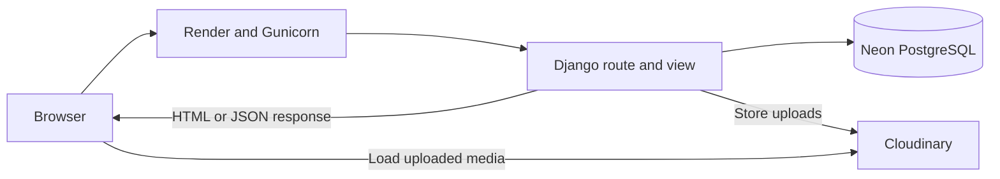

# Gaya Bhumi Website Workflow

This walkthrough follows the site from a visitor’s first request through registration, listing publication, enquiries, payments, staff review, and recovery on Render. It describes the implementation at commit `6d5e9c4` on 24 November 2026. In each flow, look for the record Django reads, the fields it writes, and the next screen that reflects those changes.

Prices, enabled features, provider selection, and production data come from the live configuration. Amounts and dates in worked examples are illustrative unless identified as the current maintenance notice.

## Contents

1. [How a request reaches the website](#how-a-request-reaches-the-website)
2. [Where information lives](#where-information-lives)
3. [Registration login and account roles](#registration-login-and-account-roles)
4. [Homepage search maps and property details](#homepage-search-maps-and-property-details)
5. [How a seller creates a listing](#how-a-seller-creates-a-listing)
6. [Editing expiry visibility and deletion](#editing-expiry-visibility-and-deletion)
7. [Listing credits and pack purchases](#listing-credits-and-pack-purchases)
8. [Payment orders confirmation and recovery](#payment-orders-confirmation-and-recovery)
9. [Saved properties enquiries and buyer matching](#saved-properties-enquiries-and-buyer-matching)
10. [Seller dashboards and analytics](#seller-dashboards-and-analytics)
11. [Administration and moderation](#administration-and-moderation)
12. [Media email search indexing and analytics integrations](#media-email-search-indexing-and-analytics-integrations)
13. [Deploying maintenance and restoring service](#deploying-maintenance-and-restoring-service)
14. [Where to check when something goes wrong](#where-to-check-when-something-goes-wrong)

## How a request reaches the website

A request is one visit to a page or one action such as submitting a form. A `GET` usually opens a page. A `POST` usually submits a change. Some Gaya Bhumi reads also record activity or apply system changes when they run.

1. **The browser sends a request to Render.** On the normal deployment, Gunicorn receives the request and passes it to Django through `config/wsgi.py`.
2. **Django applies middleware.** Middleware is code that can run around many pages. The session and authentication layers identify the signed-in account. Maintenance middleware can substitute a temporary page. Property lifecycle middleware checks whether listing or plan deadlines are due. The dedicated `/ping/` route bypasses the two database-backed middleware checks.
3. **The URL selects a view.** A view is the function that handles the URL. For example, `/search/` runs `property_list_view` and `/property/<token>/` runs `property_detail_view`. The account routes are under `/accounts/`. Django Admin is under `/admin/`.
4. **The view validates, reads, and sometimes writes.** A form checks user input. Models describe database records. A service such as `PaymentService` performs work shared across views. The database stores persistent records. A transaction groups related changes so they commit together or roll back together.
5. **Django returns a response.** Most views render HTML from a template. A successful form usually redirects to the next screen. API routes return JSON. JavaScript handles parts of the experience such as map movement, form previews, dialogs, and payment countdowns.
6. **The browser fetches assets.** CSS, JavaScript, icons, and the site logo come from the project’s static files. Uploaded property media normally comes from Cloudinary. The maintenance-only server has its own small response path, described in section 13.

For example, a property card is built from a database listing plus a template. Changing the title in the seller editor updates the listing row. On the next eligible home or search request, Django reads the new title and places it in the card. Changing only the CSS affects how the saved title looks.

[Project routes](../config/urls.py) · [Account routes](../accounts/urls.py) · [Property and payment routes](../properties/urls.py) · [Middleware](../properties/middleware.py) · [Django settings](../config/settings.py)

## Where information lives

| Location | What it holds | Typical updates |
| --- | --- | --- |
| **GitHub repository** | Python logic, HTML templates, CSS, JavaScript, static images, and migration files | A Git commit changes what a later deployment can run |
| **Render environment and deployment** | Which code version is live, how it starts, and environment settings such as `DATABASE_URL` and `RENDER_MAINTENANCE_MODE` | Editing an environment variable and deploying applies it to the new instance |
| **PostgreSQL on Neon** | Accounts, listings, enquiries, payments, balances, settings, and file references | A form submission, verified gateway event, admin action, or maintenance job writes records |
| **Django sessions** | Per-browser state such as signed-in identity, pending registration order reference, verified phone during signup, and seller dashboard mode | Account and dashboard actions update the session tied to that browser |
| **Cloudinary** | Uploaded images, videos, PDFs, and profile photos in production | A successful upload stores the file and the database stores the reference |
| **Firebase and email provider** | Firebase verifies phone possession. Brevo or SMTP delivers email generated by Django | Firebase returns a verification token. Django stores the resulting account flag after its own checks |
| **Payment provider or Android listener** | Gateway orders and payment events, or listener reports from the merchant’s UPI notifications | Django verifies the external evidence and updates its own payment and entitlement records |
| **Google Analytics and Search Console** | Public traffic measurements and Google search reporting | Analytics tags send eligible page visits. Search crawlers discover eligible URLs through public pages and sitemaps |

A **record** is a row in a database table. The model name is usually the easiest way to find it in the code. Examples include `accounts_user` for `User` and `properties_property` for `Property`.

| Record | What one row means | Key links |
| --- | --- | --- |
| `User` | One buyer, seller, or staff account | Owns listings, enquiries, requests, saved items and payments |
| `Property` | One property listing | Links to the seller, category, locality, area unit, status, visibility, and plan |
| `PropertyImage`, `PropertyVideo`, `PropertyDocument` | One attached file reference | Links to a property. The cover photo is on `Property.main_image` |
| `PropertyView` | One recorded visit to a property detail route | Links to a property, and to a viewer for authenticated visits |
| `SavedProperty` | One user’s currently saved property | Unique per user and property |
| `PropertyInquiry` | One enquiry and its seller follow-up data | Links the sender and property, with contact details submitted at the time |
| `BuyerRequirement` and `BuyerRequirementMatch` | A buyer’s search brief and a seller’s proposal | A proposal links a brief, seller, and listing |
| `PaymentTransaction` | One payment attempt for a particular purchase | Links to the paying account and, where applicable, a property, credit pack, or original attempt |
| `CashfreePaymentAttempt`, `PaymentWebhookLog`, `UnmatchedPayment` | Evidence and reconciliation records | Link back to verified payment activity or an unmatched listener event |
| `WebsiteSetting` and pricing models | The settings and prices that drive current behaviour | Django reads them for forms, publishing, support information, and new pricing quotes |

In local development, the default project setup can use `db.sqlite3` and the local `media/` directory. A local change affects production only when its code is deployed or when an authorised operation explicitly targets production data.

[Account model](../accounts/models.py) · [Property and payment models](../properties/models.py) · [Storage configuration](../config/settings.py)

## Registration login and account roles

### A new buyer or seller registers

1. The visitor opens `/accounts/register/`. Django checks `WebsiteSetting.allow_user_registration`. This determines whether the signup form is available.
2. The visitor enters a phone number. Django normalizes it to the Indian mobile number and checks whether another account already claims it. The production form uses Firebase Phone Authentication. In local development, the app can generate a six-digit test code in the browser session with a five-minute expiry.
3. After successful phone verification, Django records the verified phone, verification source, and identity marker in the **session**. At this stage the signup flow still needs a valid registration form.
4. On Submit, Django checks that the submitted phone matches the verified phone in the session. It validates the email, phone uniqueness, passwords, and chosen account details. It creates a `User` with a generated username, a password hash, and a verification token. It sets `is_phone_verified=True` and clears the temporary phone verification session data.
5. **Buyer path.** Django prepares the email verification link. In production it sends the link and shows a verification waiting page. Following the link sets `User.is_email_verified=True`, creates a login session, and takes the buyer to the buyer dashboard.
6. **Seller path with a zero registration fee.** Django assigns the configured complimentary credits if enabled and sets `is_seller_paid=True` to record that the one-time registration requirement is satisfied. The email verification flow then runs.
7. **Seller path with a positive fee.** Django saves the account and its initial allowance, then creates an order of type `seller_registration`. The session stores the order reference so that the same registration browser can open its checkout before login. Confirmed payment sets `is_seller_paid=True` and triggers the verification email. If order creation fails, the account is available for a later retry through login.
8. **Local development.** When operating in development mode, the verification email routine can mark email verified locally and direct the user straight to their dashboard. Treat that as a development shortcut when comparing it with production registration.

The initial allowance belongs to the seller’s `User.free_listings_remaining` field. The price comes from `RegistrationCharge`. A required registration payment has a separate `PaymentTransaction` and therefore a separate status and reference.

[Registration and OTP views](../accounts/views.py) · [Account forms](../accounts/forms.py) · [Phone verification integration](../accounts/firebase_auth.py)

### Login logout password reset and profile

- **Login** accepts email or username with a password. The view checks required seller activation first, then checks email verification, then creates the login session. An allowed return URL can take the user back to the page that prompted login. Otherwise the login view sends the account to its role dashboard.
- **Logout** clears the authenticated session. The buyer’s or seller’s account and business records stay in PostgreSQL.
- **Forgot password** looks up the account and sends a reset link for an eligible verified email. The link contains an encoded account ID and a Django-generated token. Submitting a valid new password updates the password hash on `User`. Local development shows a reset link in the browser.
- **Profile updates** write fields such as name, agency information, contact preferences, and the profile photo reference on `User`. A changed nonempty mobile number requires a fresh verification for that exact number. Public seller phone display depends on seller role, consent, and a stored phone number.

[Account views](../accounts/views.py) · [User fields and account helpers](../accounts/models.py)

### Buyer upgrade and seller dashboard switching

A buyer who selects **Change account type** can save seller subtype and agency details. The account gets `seller_upgrade_pending=True`. If the registration offer is zero, the service immediately changes `user_type` to seller, sets `is_seller_paid=True`, clears the pending flag, and assigns the configured starting allowance. For a positive fee, the role changes when a verified registration payment completes. A login can resume a pending upgrade.

An existing seller who chooses **Buyer Dashboard** changes `session['dashboard_view']`. The same account can save properties and browse enquiries from that workspace. Choosing **Seller Dashboard** changes the session preference back. The role and ownership checks for managing listings continue to use the seller account in `User`.

[Change account type and switch dashboard](../accounts/views.py) · [Seller activation](../properties/payment_service.py) · [Dashboard routing](../properties/views.py)

## Homepage search maps and property details

### Homepage and property search

1. A public listing is eligible for general discovery when `status=available`, `visibility=public`, and `expires_at` is in the future. The normal listing manager also hides records marked `deleted`.
2. The homepage queries that inventory for active counts, featured and recent properties, and locality activity. The same saved listing can appear in several areas because these are queries over one record.
3. Search applies the URL’s keyword, locality, type, total-price range, area unit, and sort options. Keyword matching can rank close matches. Default ordering uses relevance for keyword results, then promotion signals and recency. The price filters use **total asking price**. The cards emphasize **price per kattha**.
4. The results grid paginates nine properties per page. The map receives coordinates for eligible properties across the filtered results and omits listings with missing coordinates. The browser adjusts the initial zoom around Gaya so it can fit the markers. Abbreviated labels such as `K`, `L`, and `Cr` show the numeric kattha rate. Moving or zooming the map changes browser display state.
5. A seller’s collection link uses the same list view with an additional seller filter. A new public property appears there as soon as it qualifies for discovery.

The same navigation links to pricing, About and Contact, and the Gaya property buying guide. The pricing view uses current registration, category, plan, and buyer service records to build a role-specific display. The seller guidelines page requires sign-in. Reading these informational pages is separate from creating a checkout order.

[Home search and seller collection views](../properties/views.py) · [List and map template](../templates/properties/property_list.html) · [Public inventory rules](../properties/models.py)

### Property detail and view tracking

1. The property URL uses `Property.property_token`. It is a random token stored with the listing. The handler looks up that token with the visible manager, which returns a 404 for a deleted property.
2. The detail route explicitly redirects ordinary visitors away from expired, payment-pending, and private properties. The owner or staff can open relevant details for management. A shareable property can be discovered by someone with its direct link. General search still requires public visibility.
3. On a successful detail `GET`, Django increments `Property.views_count` and creates a `PropertyView` row in one transaction. The row captures the viewer for signed-in visits. A guest can contribute an anonymous view row. The counter measures hits, so repeated openings can increase the count.
4. The page builds the media presentation from the cover photo followed by videos and gallery images. Guests receive the cover preview. Signed-in visitors receive the full media and detail presentation. When coordinates are absent the page displays the listing’s no-location message.
5. The page checks the viewer’s bookmark and prior enquiry, then prepares similar active public properties from the same locality, or from the same property type when the locality yields none.

**Important access detail.** The search list and public inventory API exclude sold, under-discussion, and review-pending listings through the available-status filter. The current detail route applies its own narrower status checks. A public or shareable direct token can therefore still open a sold or review-pending listing if it passes the route’s visibility and expiry checks. Treat search visibility and direct-link access as separate behaviours when reviewing moderation.

[Detail handler](../properties/views.py) · [Property detail template](../templates/properties/property_detail.html) · [View model and visibility fields](../properties/models.py)

## How a seller creates a listing

### Form and price calculation

1. A signed-in seller opens `/property/add/` or a plan-specific version. The view checks `allow_property_listing`, seller role, and any required registration payment. It reads active category, plan, and area-unit data for the form.
2. The seller submits location, asking price, area, description, plan, visibility, and any media. Django validates the form and upload limits. Latitude and longitude can both be blank. If the seller provides coordinates, the form requires a valid pair.
3. The default rate calculation is **total asking price ÷ area converted to kattha**. The area-unit record supplies the conversion. The seller can enable a manual rate override. Django then retains the entered rate through later edits.
4. The server recalculates checkout using the database’s current values. **Initial listing amount = category offer price + plan offer price**, with an eligible credit setting the category portion to ₹0. The paid visibility plan price remains part of the amount. Example amounts of ₹800 for the category and ₹300 for the plan yield ₹1,100 without a credit or ₹300 with one.
5. When there is no available credit, the category needs an active `ListingCharge`. The form returns a pricing error if the charge is missing. The browser’s preview serves as information. The verified server-side quote determines the order.

[Listing form](../properties/forms.py) · [Submission and pricing logic](../properties/views.py) · [Rate calculation and area conversions](../properties/models.py)

### Saving the listing and publishing it

1. Each listing form carries a `submission_token`. Django looks up the same seller and token before creating a new listing. A repeated submission can return the existing listing or payment. The database also enforces uniqueness for this combination.
2. In a database transaction, Django locks the seller row, rechecks the token and balances, and saves the listing and its attachment records. If a media row fails before commit, the listing rows and credit change roll back together. Cloudinary storage is a separate system from the database transaction.
3. **₹0 due.** The listing becomes `available` when auto-approval is enabled or `pending_review` when staff approval is required. If a credit was used, Django consumes it as part of the same transaction. The seller receives a confirmation for publication or submission for review.
4. **Payment due.** Django sets `status=payment_pending`, `is_paid=False`, and `paid_amount` to the amount due. If the quote uses a credit, it sets a reservation flag and records which balance the credit should come from. It saves the listing before trying checkout.
5. The checkout starts with a `PaymentTransaction` for that property. If gateway order creation fails, the saved listing and reservation are available for retry. A verified payment later marks the listing paid, consumes the reserved credit, and sends it to `available` or `pending_review` according to the auto-approval setting at confirmation time.
6. In Django Admin, staff can change a `pending_review` listing to `available` with the approval action. A paid visibility period starts on publication for a moderated listing. Search shows the listing after publication if its visibility is public and its property expiry is in the future.

[Create and retry views](../properties/views.py) · [Payment completion](../properties/payment_service.py) · [Approval action](../properties/admin.py)

## Editing expiry visibility and deletion

### Editing the listing and its files

The seller’s editor verifies ownership and updates the existing `Property` row. It can update editable fields such as description, price, viewing visibility, location, and media. The property category and listing plan are fixed in this form. Payment-pending, review-pending, and expired statuses are protected from an ordinary edit. The seller uses the separate **Change plan** action for visibility plans and **Change expiry date** for the listing deadline.

New gallery items, videos, and documents add related media rows. “Remove media” clears the cover field or deletes the selected attachment row. File cleanup runs through the storage workflow in section 12. The **Sold/Available** switch updates `Property.status` and the update timestamp. The switch requires a supported starting status and blocks reopening an expired sold listing until its expiry is addressed.

[Edit media and listing management views](../properties/views.py) · [Form field and status rules](../properties/forms.py)

### The three clocks

| Clock | Field | Starting point | What happens when due |
| --- | --- | --- | --- |
| **Property listing** | `Property.expires_at` | A new listing receives a date two calendar years from its initial default date | Lifecycle records the previous status in `status_before_expiry` and sets `status=expired`. Public inventory filters also check the timestamp |
| **Preferred visibility plan** | `Property.plan_expires_at` | Starts from publication or the applicable plan change using the scheme’s duration | Lifecycle sets the plan to Basic (`free`), clears the date, and removes featured and sponsored flags. A still-valid listing can continue in Basic |
| **Payment checkout** | `PaymentTransaction.expires_at` | Comes from the UPI QR window or a gateway session where applicable | Checkout may expire. The seller’s history keeps the order and can offer a fresh attempt for an eligible purchase |

The listing clock is initialized for the property record, including during payment or moderation. The paid visibility clock starts when the relevant publication or plan transition takes effect. A Basic plan has no separate plan deadline. A plan configured with zero duration stores no timed plan cutoff and remains subject to the listing’s own lifetime.

**Example.** A listing created on 24 November 2026 has a property deadline of 24 November 2028. A 60-day plan that starts on 24 November 2026 ends on 23 January 2027. The listing then moves to Basic and can stay public through its property deadline if still available. Adding three months to the property deadline in advance moves it to 24 February 2029. Preferred visibility follows its own plan deadline throughout.

[Expiry fields and methods](../properties/models.py) · [Lifecycle updates](../properties/lifecycle.py) · [Property lifecycle migration](../properties/migrations/0045_property_lifecycle.py)

### Seller changes a property expiry

1. The seller opens **Change expiry date** from the dashboard. The dialog pre-fills the current date and offers **1 month**, **3 months**, **6 months**, or **1 year**, alongside the exact-date choice.
2. Django checks ownership and eligibility. Available, sold, and under-discussion listings are eligible. An expired listing can be changed when its prior status was eligible.
3. A duration adds calendar months from whichever is later, the current expiry or now. If the resulting month has fewer days, the end date falls on its last day. An exact date is valid for today or later and is stored at the end of that date in the site’s time zone.
4. Django updates `expires_at` and clears `expiry_reminder_sent_at` so a reminder can be sent for the new date. For a record already marked expired, it restores its previous status. A listing restored to sold retains that sold status.
5. The seller action applies to the property deadline. Preferred visibility follows the plan, and an expired or downgraded plan requires a new plan change for renewed promotion.

[Expiry change handler](../properties/views.py) · [Expiry date dialog](../templates/properties/seller_dashboard.html) · [Calendar date functions](../properties/models.py)

### Seller changes a plan

An eligible available or sold listing can change to an active plan. When the new plan costs more, Django quotes the positive difference between offer prices and creates a property payment with the source and target plan in its notes. The current plan remains in effect while payment is pending. On confirmed payment the service applies the selected plan and its scheme duration, adds the upgrade amount to the listing’s payment history fields, and checks that the listing’s current plan still makes sense for that upgrade.

A lower-priced or equal-priced change can take effect immediately. The code caps the new timed expiry at the shorter of the previous and new plan periods when both dates exist. A change to Basic clears promotion flags. The purchase has no automatic refund as part of this action.

[Plan change handler](../properties/views.py) · [Plan change confirmation](../properties/payment_service.py)

### Seller or staff deletes a property

1. The seller confirms **Delete** on a listing they own. Staff with the appropriate permission can use **Mark selected listings as deleted** in Django Admin.
2. Django sets `Property.status=deleted` and writes `deleted_at` and `updated_at`. The property row and its linked history remain in the database.
3. Seller and buyer lists, public search, direct detail, and the relevant dashboard sections exclude the archived listing. For a property payment linked to that listing, seller-facing history excludes it too.
4. Django Admin reads `Property.all_objects`. Staff can filter by **Deleted** and inspect the retained record alongside the seller and associated records. The property admin disables ordinary permanent delete and makes deleted records view-only through its normal edit flow.
5. A saved bookmark, enquiry, or payment linked to the listing can therefore still exist in storage even when the customer dashboard no longer displays it. A listing credit already spent remains spent. An unused reservation is no longer counted once the listing stops being an eligible payment-pending listing.

The delete action preserves the state of the listing and related records at deletion. The property row holds the latest saved field values. An ordinary edit replaces those values in place.

[Soft deletion and managers](../properties/models.py) · [Seller delete](../properties/views.py) · [Staff archive and history](../properties/admin.py)

## Listing credits and pack purchases

### What the balance means

The seller has two balances. `free_listings_remaining` holds granted complimentary credits. `purchased_listing_credits` holds unused paid-pack credits. Available amounts deduct active reservations from each balance. The dashboard’s available free-listing total combines the two usable amounts. The admin’s **Allow free listing** setting gates the complimentary balance. Purchased credits are usable even when complimentary listing credits are disabled.

Django spends available complimentary credits first, followed by purchased credits. A credit waives one category charge. For a listing with no amount due, the credit is consumed when the listing and media rows commit. For a listing with a plan charge, Django reserves a specific credit when creating the pending listing, then consumes it on confirmed payment. The reservation prevents two pending listings from promising the same credit.

**Example.** A seller has 2 complimentary credits and buys 5. After verified payment, the balance shown is 7, assuming no reservations. Posting one Basic listing with nothing due leaves 6. Submitting a second listing with a paid plan reserves another credit, so the dashboard shows 5 available. When that plan payment confirms, the seller’s stored balance drops by one and the reservation clears. The available figure stays at 5 in this example because the reserved credit was already subtracted from the displayed balance.

[Balance and reservation calculation](../properties/listing_credits.py) · [User balance fields](../accounts/models.py) · [Listing submission](../properties/views.py)

### How a credit pack is bought

1. Staff creates or edits a `ListingCreditPack` in the admin dashboard. The record contains name, number of credits, MRP, current price, display order, and active flag. The price validation requires a minimum of ₹1 and an MRP at least as high as the current price.
2. The seller opens **Buy more credits** from the dashboard. The shop reads active packs and shows credit quantity, MRP, actual price, discount, and price per listing. For a reusable open order, it displays that order’s stored quote.
3. **Buy** submits the pack ID. In a transaction Django locks the seller, checks for a reusable open purchase for that pack, and otherwise locks the active pack and creates a `PaymentTransaction` with type `listing_credits`. It saves the pack reference, `credit_quantity`, `amount`, and `mrp` in the order.
4. The seller enters checkout. Opening the checkout leaves the transaction pending. A gateway confirmation, as described below, is what changes the balance.
5. On first confirmation, Django increments `User.purchased_listing_credits` by the order’s stored `credit_quantity`, records `credits_applied_at`, and sets the payment to `completed` in the same database transaction. Repeated confirmation uses the prior completion.
6. The dashboard reads the updated balance. Existing orders retain their stored quote if staff edits a pack later. A fresh pack order uses the currently active pack and price, subject to reuse and payment recovery checks.

[Credit pack model](../properties/models.py) · [Shop and purchase view](../properties/views.py) · [Credit shop cards](../templates/properties/listing_credit_shop.html) · [Verified credit application](../properties/payment_service.py)

## Payment orders confirmation and recovery

### The order and what it will release

Property asking prices describe the seller’s offer. Buyers and sellers discuss a property deal through enquiries or direct contact. The website checkout covered here collects the platform’s seller registration fees, listing and plan charges, and credit pack prices.

The application records **one row per payment attempt** in `PaymentTransaction`. The local `order_id` begins with `GB_` and appears in the checkout route. The provider can issue its own order or payment reference. An order stores the payer, purchase type, quoted rupees and MRP, current status, provider, dates, and the linked listing or pack where applicable. The seller sees status, amount, reference, and the appropriate action in Payments. The channel metadata is available in the backend record.

The custom admin dashboard saves the active provider on `WebsiteSetting.payment_provider`. If it is blank, Django uses the `PAYMENT_PROVIDER` environment setting. The provider selected for new orders can differ from the provider on a previous order. Each checkout continues to use its own stored provider.

| Purpose | When the order is created | What verified completion writes |
| --- | --- | --- |
| Seller registration | Registration or login requires a one-time seller fee | Sets `User.is_seller_paid` and schedules the account verification email |
| Buyer to seller upgrade | A buyer requests the change and a fee is due | Sets seller role and seller activation, clears `seller_upgrade_pending`, assigns complimentary credits, and schedules the upgrade email |
| Initial listing payment | Category plus plan, after applying any credit, produces an amount due | Updates the property’s payment status, consumes any reserved credit, and publishes or sends it to staff review |
| Paid listing plan change | An active listing moves to a higher-priced plan | Applies the target plan and scheme deadline when eligible and adds the amount to the listing’s payment value |
| Credit pack | A seller selects an active pack | Adds the quoted credit quantity once and records `credits_applied_at` |

The payment service locks the attempt row before completion. For a linked retry it also checks the original attempt group for a prior completion. It applies the purchase result and the payment status together in a transaction. Emails scheduled after commit describe changes that actually persisted. A late confirmed listing payment can remain in the payment record while an expired or deleted listing stays closed.

Refunds and chargebacks require staff reconciliation. Review the provider record and the affected purchase together, since payment status, listing visibility, and available credits are stored separately.

[Payment order fields](../properties/models.py) · [Order creation and completion](../properties/payment_service.py) · [Checkout and payment history views](../properties/views.py)

### Cashfree hosted checkout

1. Django saves a pending payment. It initializes a Cashfree order using the local order reference, quote, buyer or seller account reference, and return and webhook URLs. For a credit pack, initialization happens when checkout opens. Other Cashfree orders may initialize when they are created.
2. The server sends the request with an idempotency key derived from the existing order. If the create request times out, the code looks up that same order. The local row records the Cashfree order ID, payment session, expiry, and whether it is sandbox or production.
3. The browser uses the hosted checkout session. The return page shows the current confirmation state. An owned status request asks the server to verify with Cashfree and is throttled to limit repeat calls.
4. A signed Cashfree webhook can arrive separately. Django verifies the event and re-fetches data from Cashfree before completing a purchase. It checks the order and customer references, exact INR amount, and that Cashfree reports a successful captured payment. A browser URL parameter claiming success never fulfils a purchase.
5. A verified success records the Cashfree attempt audit, the completed payment, and the purchased result together. A failed or abandoned gateway attempt can be recorded separately while the original local order stays available for other allowed attempts until closed.
6. A completed Cashfree order can show its receipt to the owner or eligible registration session. If the return or webhook was missed, the reconciliation command checks matching pending and expired Cashfree orders against the gateway again.

[Cashfree server API and validation](../properties/cashfree.py) · [Return webhook status and receipt](../properties/cashfree_views.py) · [Cashfree operating guide](CASHFREE_SETUP.md)

### Razorpay checkout

1. In production Django creates a Razorpay order through its API, using the database quote converted to paise. The local row stores the provider’s order ID.
2. The browser opens Razorpay checkout and submits the result to `/payment/verify/`. Django first checks whether the caller owns the order or has its authorised registration session.
3. Django verifies the signature, then fetches the payment from Razorpay. It checks the linked order, currency, amount, and captured status before calling the shared completion service.
4. Local development supports a demo Razorpay path. Its simulated orders and payment identifiers are for local tests. A production verification requires the real provider configuration and evidence.

[Razorpay order and signature verification](../properties/payment_service.py) · [Payment verification endpoint](../properties/views.py) · [Checkout template](../templates/properties/payment_checkout.html)

### Direct UPI and the Android listener

1. Django creates a pending order with an exact amount and expiry based on the configured QR window. It builds a QR and UPI link using the merchant details. The browser polls the order status while the seller pays through a UPI app.
2. The seller can submit their 12-digit UPI reference number, called a **UTR**. That updates `customer_submitted_utr` and can put the payment into **Awaiting confirmation** in the dashboard. The submitted reference is a claim for checking.
3. The merchant listener reports a bank notification to the UPI webhook. The server verifies the listener’s credentials and validates the event. It writes a `PaymentWebhookLog` with the bank reference and event data used for review.
4. The code searches pending, unexpired UPI orders for the exact amount and a normalized payer name matching the account’s display name. A single match can be completed with the bank reference. An ambiguous or unmatched event becomes an `UnmatchedPayment` for review.
5. A confirmed UPI payment stores the verified UTR and available payment metadata, completes the purchase, and lets the browser open the receipt. The unique UTR guards against reapplying the same bank payment.

[Direct UPI checkout and listener workflow](../properties/views.py) · [UPI audit models](../properties/models.py) · [Dashboard payment action](../templates/properties/_dashboard_payment_action.html)

### A payment expires or needs a fresh attempt

1. The seller’s Payments section calculates the active order’s effective state from its status and expiry. On entry to the dashboard, due pending UPI orders are marked expired in the database.
2. With more than 60 seconds left, an eligible attempt shows **Pay now** and its countdown. In the last minute, the dashboard hides Pay now and displays the about-to-expire message. If the seller selects **Make fresh payment** at that point, the browser waits for expiry before sending the request. The server also checks the deadline.
3. After expiry or an eligible failure, the fresh-payment endpoint checks purchase eligibility and whether a reference is already awaiting confirmation. For Cashfree it verifies that the remote order and previous payment attempts are closed before replacing them. If Cashfree reports a successful payment instead, the server can complete that payment and show its receipt.
4. A newly created retry uses its own order ID, with `retry_root_id` pointing to the original attempt. The dashboard detects newer attempts in that group. Only the latest eligible attempt shows a payment action. Older rows stay readable as **Replaced by a newer attempt**. A stale form or checkout link cannot restart the old attempt.
5. When an attempt in the group succeeds, the others show **Paid on another attempt**, and the completion service blocks a second application of the same purchase. Other independent purchases are separate groups.

**Three-attempt example.** Order A expires. A fresh checkout creates B, and A loses its payment action. B expires, so the next fresh checkout creates C with the same original reference. Until C succeeds, only C can offer the next payment action. Once C completes, it records the purchase, while A and B remain as expired history. For a five-credit pack only the successful application adds the five credits.

The initial listing retry takes the amount stored on the property when it was submitted. A fresh pack order uses the current active pack pricing if no reusable order takes precedence. A fresh plan-change order can recalculate the offer-price difference for the selected target plan.

[Payment history and retries](../properties/views.py) · [Countdown logic](../static/js/seller-payment-countdown.js) · [Payment attempt linking migration](../properties/migrations/0048_payment_retry_root.py)

## Saved properties enquiries and buyer matching

### Saving a property and seeing it again

1. A signed-in visitor selects **Save**. The toggle adds a `SavedProperty` row for that account and property. The next toggle removes that row.
2. The buyer dashboard selects saved items the account can still see in its saved view. The saved count and visible card list use slightly different conditions, so an unavailable but retained bookmark can affect the count while its card is hidden.
3. Recently viewed cards come from the signed-in account’s `PropertyView` records. Recommendations prefer localities represented in saved listings and use currently available public inventory. They exclude already-saved or previously viewed properties.

[Save action and buyer dashboard](../properties/views.py) · [Saved property record](../properties/models.py)

### Sending an enquiry and recording seller follow-up

1. A signed-in visitor opens the property. The enquiry form pre-fills their available contact details. A seller opening their own property cannot send an enquiry to themselves.
2. On submit, Django validates the form, rejects a repeated enquiry from the same user for that property, and applies the limit of five non-spam enquiries in the preceding hour. A hidden bot-trap field allows the app to discard some automated submissions.
3. Django inserts `PropertyInquiry` with the sender, property, submitted contact details and message, and the default follow-up status. After commit it attempts the seller notification.
4. The seller dashboard loads enquiries for properties owned by that seller and excludes spam and archived properties. The seller can use the buyer’s submitted phone or WhatsApp contact details and record the result.
5. Saving follow-up updates `status`, `seller_responded`, `seller_responded_at`, `seller_notes`, `is_read_by_seller`, and `updated_at`. The buyer dashboard shows their sent enquiries and response state. The seller’s private follow-up notes are used on the seller and admin side.
6. An external phone call or WhatsApp message goes through that external application. The seller’s follow-up save is what updates the portal’s lead status.

[Enquiry and follow-up endpoints](../properties/views.py) · [Enquiry status and fields](../properties/models.py) · [Notification preparation](../properties/notifications.py)

### Buyer Match Desk and seller demand board

1. A signed-in user submits a structured brief with property type and optional locality, budget range, and area range. Django creates a `BuyerRequirement` for that account. The creation flow caps requests at 10 in the preceding 24 hours and up to 5 active recent requests.
2. The matching query checks active public listings against type, locality, total asking price, and area. It uses the configured area conversion when the requirement and listing have different units.
3. Buyers can pause or reactivate their own request. The action changes `is_open` and `updated_at`. An open request older than 30 days by its update date becomes stale for matching. Reactivation refreshes the date.
4. On the **Buyer Demand** page, each seller sees the eligible briefs and their own matching public listings. Buyer contact details remain private in this flow.
5. When a seller sends a match, Django rechecks that the request is open and recent and that the selected listing is eligible. It saves a `BuyerRequirementMatch` with the seller, brief, listing, and optional message. The database limits a seller to one match per requirement.
6. A buyer notification is scheduled after commit. The buyer sees the proposal in the Match Desk while its listing meets the display conditions. A proposal is a suggestion for the buyer to consider. An enquiry follows its own contact workflow.

[Buyer requirement and demand views](../properties/views.py) · [Buyer request and match models](../properties/models.py) · [Match notification](../properties/notifications.py)

## Seller dashboards and analytics

### What changes the dashboard

The seller dashboard combines the seller’s own listings, view activity and saves, enquiries, available credits, recent payment history, and buyer-demand shortcuts. The page builds most numbers from database queries each time it opens. It also saves the seller dashboard preference in the session and closes the seller’s due pending UPI orders.

| Dashboard item | Data source | What causes the next refresh to change |
| --- | --- | --- |
| Total listed and property status | Seller’s visible `Property` rows | Listing creation, staff approval, sold toggle, expiry, extension, or soft deletion |
| Views | `Property.views_count` and `PropertyView` | A counted visit to the detail page |
| Buyer activity on a listing | Recent authenticated views, recent non-spam enquiries, and current saves | View recorded, enquiry submitted, save added or removed |
| Local rate comparison | Available public listings from other sellers in the same type and locality | A comparable listing’s rate, status, or eligibility changes |
| Available free listings | The two seller balances, adjusted for active reservations | Credit pack settles, a listing uses or reserves a credit, or a reservation stops qualifying |
| Payments | Seller’s `PaymentTransaction` rows, excluding archived properties | Order created, expires, gets replaced, is confirmed, or changes status |
| Lead inbox | Non-spam `PropertyInquiry` rows for the seller’s listings | New enquiry, follow-up save, staff spam flag, or listing archive |

[Seller dashboard query and filters](../properties/views.py) · [Dashboard layout](../templates/properties/seller_dashboard.html)

### Analytics page and chart definitions

1. The seller opens `/dashboard/seller/analytics/` and chooses 7, 30, 90, or 365 days. The query uses the site’s local calendar and defaults to 30 days. The seller can filter to a listing they own and choose a sort order.
2. The audience counts use authenticated property views and exclude the seller’s own views and staff views. Unique audience is a distinct viewer count. Lifetime property hits are the property counters and can include guest and repeated views. The analytics page’s guest estimate is the nonnegative difference between those counters and its recorded-view row count. It is distinct from a count of all guest view rows.
3. Enquiries exclude spam. The page computes counts by status, response rate, and average recorded response time. Enquiry rate divides matching-period enquiries by tracked views when that denominator exists. A missing denominator yields no percentage.
4. Save metrics use the creation dates of save rows that still exist. Removing a bookmark removes its row and can change the historical plot. The page also counts seller match proposals.
5. Payment totals are filtered by order creation date and status. With a selected property they refer to that property. The overall seller view can include account payments without a property. Cashfree sandbox orders are flagged separately and excluded from the displayed paid totals.
6. Activity is plotted in daily buckets up to 30 days, seven-day buckets up to 90 days, and 30-day buckets for the yearly view. The page also shows portfolio breakdowns, upcoming property and plan expiries, and a listing performance table. Asking-value totals use the listed prices for eligible available inventory.
7. The browser draws the charts from PostgreSQL queries over the existing records.

[Analytics calculations](../properties/seller_analytics.py) · [Charts and tables](../templates/properties/seller_analytics.html) · [Chart rendering](../static/js/seller-activity-chart.js)

## Administration and moderation

### Custom admin dashboard

Staff opens `/dashboard/admin/` for a business view of recent activity and grouped settings. Django validates each submitted configuration form and stores the values in its model. Changes made here are database updates, so application code reads them on subsequent requests without a Git deployment.

| Control | Model or field updated | Where the change appears |
| --- | --- | --- |
| Registration open and listing open | `WebsiteSetting.allow_user_registration` and `allow_property_listing` | Signup and new listing access gates |
| General settings | `WebsiteSetting` site name, support contacts, maintenance, approval, and internal notes fields | Selected site displays and notifications, the Django maintenance switch, and listing publication decisions |
| Complimentary listing policy | `WebsiteSetting.allow_free_listing` and `free_listings_per_seller` | Starting grants for eligible new sellers and whether their complimentary balance is usable. Existing seller balances are stored on individual accounts |
| Category prices | `ListingCharge` by property category | Listing form pricing and category price used on a new quote |
| Visibility plan prices and duration | `ListingPlanChoice` | Active plan choices, quote calculation, and the duration used when a plan starts |
| Seller registration price | `RegistrationCharge` | New seller activation and buyer-to-seller upgrade quotes |
| Buyer service pricing | `BuyerServiceCharge` | Buyer-facing prices and descriptions on the pricing page. These displayed services are outside the three currently implemented payment order types |
| Credit packs | `ListingCreditPack` | Active shop cards and new pack quotes. Deactivation removes a pack from new purchases while retained payment records keep its reference |
| Media upload limits | `WebsiteSetting` media counts, per-file sizes, and combined maximum | Server validation and remaining-slot guidance on create and edit forms |
| Gateway and merchant details | `WebsiteSetting.payment_provider`, merchant UPI fields and QR duration | Provider for new orders. Gateway and listener secrets live in the Render environment |

The dashboard also prepares seven daily bars for the current local date and the preceding six days. **Listings** group `Property.created_at` from the full property table, including archived rows. **Views** group `PropertyView.viewed_at`. The scale is based on the peak day. Other dashboard counters have their own filters and may cover a different group of records.

[Admin dashboard views and chart data](../properties/views.py) · [Settings and pricing forms](../properties/forms.py) · [Admin dashboard template](../templates/admin/admin_dashboard.html)

### Django Admin

Django Admin under `/admin/` shows individual records to staff with the appropriate model permissions.

- **Users.** Search the account, check role and verification flags, and inspect its starting allowance and purchased-credit balance. The purchased balance is read-only in the user administration form. The user, listings, and payments are separate records.
- **Properties.** Open the listing with media records and seller link. Review the status and expiry fields, apply the approval or archive action, or mark the specific verification checks that staff completed.
- **Catalogue records.** Manage property categories, locality labels, area units and conversions, facing options, document types, statuses, visibility options, and listing plans. A choice’s active flag controls whether it is offered in relevant forms.
- **Review badges.** “Seller phone verified,” “Documents reviewed,” and “Location confirmed” are fields on the property. Staff document review covers file presence and readability. Location confirmation covers consistency between the map pin and submitted address. Registry readiness and mutation information are seller-reported property attributes.
- **Enquiries and Match Desk.** Inspect enquiries and structured requirements, mark spam, and inspect seller matches. Marking spam changes the enquiry flag so normal dashboards filter it.
- **Payments.** Find the row by order reference or payer, inspect its status and gateway identifiers, and compare linked Cashfree attempts or UPI records. Unmatched UPI notices are available for staff review. A local payment record and a bank receipt provide different evidence and should be compared before investigating an incorrect entitlement.
- **Cloudinary cleanup.** Inspect queued deletion retries for files that have stopped being referenced. A staff archive preserves the whole property record and is distinct from removing a specific attachment.

[Property and payment admin](../properties/admin.py) · [Account administration](../accounts/admin.py)

## Media email search indexing and analytics integrations

### Upload validation and storage

1. A seller uploads files in the listing form. Django checks each file’s size and actual format, combined submission size, and the number of attachments permitted for the listing. Accepted listing photos include JPEG, PNG and WebP. HEIC/HEIF photos are prepared for use by the image conversion path. Videos accept supported MP4, MOV, and 3GP formats. Listing document uploads are checked as PDFs.
2. In production, the cover and gallery images use Cloudinary’s image storage, videos use video storage, and documents use raw storage. User profile photos use the default image storage. PostgreSQL records each associated name or path in the listing or attachment fields.
3. Replacing or removing a file triggers a model signal. When the old name has no remaining database reference, Django queues a `CloudinaryCleanupTask` and attempts removal after the database commit. The retry checks references again before removing the remote file.
4. A successful cleanup removes the task. A failure records its error and attempt count for future retry. When using a local media backend, cleanup runs after commit against local files. Property soft deletion retains its existing media references for history.

This is why a photograph can fail to load while the listing still exists. The property row and the image bytes are in different systems. The file field connects them.

[Upload preparation and validation](../properties/views.py) · [Media backends](../properties/storage.py) · [Model signals](../properties/signals.py) · [Cleanup records and retries](../properties/media_cleanup.py)

### Email and external contact

- **Firebase** handles production phone verification. The website uses its own session and `User.is_phone_verified` to record the result of checks performed by Django.
- **Email** is generated by Django. Production uses Brevo’s HTTPS email backend when configured and otherwise uses the configured SMTP backend. Registration verification and activation, password reset, listing confirmation, enquiry notifications, and seller match alerts have separate triggers.
- **Retry behaviour** depends on the workflow. A failed enquiry or listing email can leave a valid database record for the completed action. The listing expiry command records its reminder timestamp only after successful delivery.
- **Phone and WhatsApp** links open the external app or phone dialler. Seller contact visibility is based on the stored account permission. Staff can change general website support information in `WebsiteSetting`. The payment help card’s named manager and number come from its checkout template.

[Production services configuration](../config/settings.py) · [Notification functions](../properties/notifications.py) · [Payment help card](../templates/properties/_payment_help.html)

### Sitemap public JSON and website analytics

1. **Public search and Google indexing** use `SEO_SITE_URL` as the canonical site origin. `/robots.txt` points crawlers to `/sitemap.xml`. The sitemap index links to public pages, curated collections with inventory, and eligible public property details. A listing’s `updated_at` supplies its sitemap last-modified date.
2. **Curated location and category pages** are routes defined in the collection catalogue. They read current inventory and show prewritten guidance. Empty collections are excluded from collection sitemaps and tagged for no indexing. Arbitrary search filters and nonpublic listing details receive restricted indexing metadata.
3. **The public JSON API** at `/api/properties/` returns up to 50 available public properties, with keyword and locality filters supported by that route. It returns basic property attributes, prices, coordinates when present, and permitted seller contact data.
4. **GA4** is controlled by a Render environment setting and the analytics template. It sends public page activity when enabled, using fixed page titles and URLs without query strings. Staff visits, local development, private or ineligible listing details, and account and payment routes are excluded from this tag.
5. **Internal analytics** uses Django’s property detail events, counters, enquiries, saves, and payment rows. These build the seller and admin dashboards. Google Analytics reports public-site traffic in Google’s interface. Search Console reports crawl and search visibility separately.

[SEO collections](../properties/seo_collections.py) · [Sitemaps and robots file](../properties/seo.py) · [Page metadata](../properties/templatetags/seo_tags.py) · [GA4 inclusion rules](../properties/templatetags/analytics_tags.py)

## Deploying maintenance and restoring service

### Normal deployment

1. A commit reaches GitHub. The Render service deploys the configured branch automatically when enabled, or an operator chooses **Manual Deploy → Deploy latest commit**.
2. In a normal build, `build.sh` installs dependencies, runs `collectstatic`, then runs `migrate` using the configured `DATABASE_URL`. `collectstatic` assembles the site’s bundled assets and `migrate` applies database changes in dependency order.
3. If the build completes, Render starts Gunicorn and imports `config.wsgi`. With the maintenance-only flag off, Gunicorn starts Django. Production settings use PostgreSQL for application data and Cloudinary for uploads.
4. A build error stops that deploy before the new version starts. Render can continue serving the last successful deployment. A database connection error can still affect that older version when it tries to read the same production database.
5. When the app is running, a request that needs data can wake a healthy idle Neon database. The app’s `/ping/` endpoint can respond without database queries and is the target of the GitHub Actions keep-alive configured every ten minutes.

[Render build script](../build.sh) · [Web entry point](../config/wsgi.py) · [Keep-alive schedule](../.github/workflows/keep-alive.yml)

### What a migration changes

A migration is a versioned update to the database schema or existing data. Django tracks applied steps in the database it is connected to. A migration applied to local SQLite is separate from a migration applied to production PostgreSQL.

- `0045_property_lifecycle` introduced the plan clock, deletion timestamp, and prior property status. It moved existing listings onto the two-year property lifetime and retained or derived their prior plan timing.
- `0046` added the listing credit pack model, quote quantity and completion fields, and the property’s purchased-credit reservation marker. Its `accounts.0008` dependency added the purchased balance to each user.
- `0047_credit_pack_mrp` added the credit pack MRP. It initially copied each existing pack’s current price into MRP so older packs had valid data, then applied the price relationship constraint.
- `0048_payment_retry_root` added a nullable link between a replacement payment and its original order. New linked retries use the field. Older orders can remain independent records.

To see which steps are pending, check the migration records on the target database.

[Lifecycle migration](../properties/migrations/0045_property_lifecycle.py) · [Credit pack migration](../properties/migrations/0046_listingcreditpack_paymenttransaction_credit_quantity_and_more.py) · [User balance migration](../accounts/migrations/0008_user_purchased_listing_credits.py) · [MRP migration](../properties/migrations/0047_credit_pack_mrp.py) · [Retry link migration](../properties/migrations/0048_payment_retry_root.py)

### Two maintenance controls

| Control | Stored in | Intended situation | What a visitor receives |
| --- | --- | --- | --- |
| **Django maintenance mode** | `WebsiteSetting.maintenance_mode` in PostgreSQL | Planned website work while Django and its database are available | The maintenance page for ordinary public requests. Staff, admin sign-in paths, static assets, `/ping/`, and the Cashfree webhook have middleware exceptions |
| **Render maintenance-only deployment** | `RENDER_MAINTENANCE_MODE=1` in the Render environment | The website must show a maintenance page even when the database is unavailable | A standalone maintenance page with HTTP 503. `/ping/` and the explicitly served logo asset respond with HTTP 200 |

Both use `templates/maintenance.html`. The standalone server reads it from disk and serves the existing logo from `static/img/GayaBhumi_Logo.png`. This is why the logo works in the outage deployment despite assets normally being prepared by `collectstatic`.

[Database-backed maintenance middleware](../properties/middleware.py) · [Standalone maintenance server](../config/maintenance_wsgi.py) · [Maintenance page content](../templates/maintenance.html)

### From a Neon outage back to the live site

1. In the current incident, Neon reported that the monthly compute allowance was exhausted. Its console showed a reset on **1 December 2026 at 5:30 a.m. IST**. The date on the maintenance page is display text.
2. To display that page, set `RENDER_MAINTENANCE_MODE=1` on the existing Render service. Save the environment update and manually deploy the latest commit. If an HTTP health path is configured, `/ping/` lets the maintenance instance pass health checks.
3. The maintenance build installs dependencies and finishes before Django static collection and migrations. Gunicorn starts the standalone handler. Browser requests to the homepage and app pages get the maintenance response, with HTTP 503 and a retry hint. Login, listing, and payment processing are paused in this mode.
4. PostgreSQL remains the place where the existing business data is stored. The standalone server reads the notice and logo from the code checkout. Reaching the public notice or its ping proves the web process is responding. It says nothing about database connectivity.
5. After Neon accepts connections, set `RENDER_MAINTENANCE_MODE=0` and trigger a full deploy. The build collects static files and applies pending migrations. A successful deploy starts the normal app on the same address.
6. Use the homepage and an eligible listing to confirm reads, then sign in to check the data on a dashboard. If gateway payments were interrupted, inspect pending orders and reconcile with the relevant provider. The Cashfree command can check remote status and apply a verified purchase.
7. The standalone server’s switch is manual. The Neon quota reset allows database connections again. Changing the Render environment and deploying selects the normal app.

[Production startup code](../config/wsgi.py) · [Build switch](../build.sh) · [Cashfree reconciliation](../properties/management/commands/reconcile_cashfree_payments.py)

### Jobs and when they run

| Process | Trigger | What it reads and updates |
| --- | --- | --- |
| Property and plan lifecycle | Normal Django view requests apart from `/ping/`, or `python manage.py update_property_lifecycle` | Checks deadlines and writes expired property statuses or Basic plan downgrades when due |
| Listing expiry reminder | `python manage.py send_listing_expiry_reminders`, when run manually or scheduled | Finds eligible public or shareable available listings due within seven days. A successful reminder sets `expiry_reminder_sent_at` |
| Cashfree recovery | `python manage.py reconcile_cashfree_payments --limit 100`, when run manually or scheduled | Rechecks eligible pending or expired Cashfree orders and applies verified completions |
| Cloudinary cleanup | A committed media change and, for retries, `python manage.py cleanup_cloudinary_media` | Rechecks file references, removes unused files, or retains retry details |
| Render keep-alive | GitHub Actions schedule | Sends `HEAD /ping/`. The ping answers without touching the application database in the current code |

The management commands are available in the repo. A recurring run of a management command requires a schedule or operator action. The GitHub workflow is the checked-in schedule for ping.

[Management commands](../properties/management/commands/) · [Keep-alive workflow](../.github/workflows/keep-alive.yml)

## Where to check when something goes wrong

Start with the action that would have written the state you expected. A visible page, email, browser countdown, or bank alert can tell you part of the story. The database row shows what the portal has actually recorded.

| What you see | First place to look | Fields or records to compare |
| --- | --- | --- |
| Phone verified on screen and signup still rejected | Registration form and OTP session | Verified number in the session, submitted number, existing `User.phone_number`, and form validation |
| Seller cannot list after registering | Account and registration payment | `user_type`, `is_phone_verified`, `is_email_verified`, `is_seller_paid`, and latest registration order |
| Listing exists and search cannot find it | Property record in Django Admin | `status`, `visibility`, and `expires_at`. Check whether payment or staff approval is due |
| Listing appears in cards without a map pin | Property editor | `latitude` and `longitude` on the same listing |
| Preferred visibility dropped while the listing remains active | Property management and plan configuration | `listing_plan`, `plan_expires_at`, promotion flags, and the separate `expires_at` |
| Seller clicked delete and needs the old listing | Django Admin → Properties → Deleted | Seller, `status=deleted`, `deleted_at`, attachment rows, and associated payments or enquiries |
| Free-listing total is lower than the raw user balance | Seller dashboard and pending listings | Complimentary and purchased credits, pending property reservations, and the complimentary setting |
| Money was debited and the portal shows pending | Payment Transactions and gateway evidence | The `GB_` order reference, amount and provider. Check the gateway’s captured status or the UPI listener record before replacing the order |
| Pack payment confirmed and credit quantity is disputed | Credit pack payment and account | `credit_quantity` and `credits_applied_at` on the order, `purchased_listing_credits` on `User`, and any subsequent listing reservations or deductions |
| Seller says an enquiry never arrived | Enquiry record and email delivery logs | Property, sender, `is_spam`, and creation date. A saved record can exist even if email delivery failed |
| Buyer and seller chart totals differ | Metric definition and date filter | Date range, view counters versus view rows, authenticated audience rules, excluded staff or self activity, and sandbox payment filters |
| A page renders and an image fails | File reference and Cloudinary | Database file field, media type and storage path, Cloudinary asset, and any cleanup task |
| Render deploy fails before the site starts | Render Events and build logs | Dependency install, static collection, database connectivity, migrations, and startup. The first actual error identifies the failing step |
| Maintenance notice remains after Neon returns | Render Environment and deployed commit | `RENDER_MAINTENANCE_MODE`, the latest deployment, and whether the normal build ran migrations |

**An end-to-end trace.** A seller submits a public listing with a paid plan and a listing credit. Django saves a `payment_pending` property, its file references, the reserved-credit type, and a pending order. Gateway confirmation completes the order and consumes the reserved credit in one transaction. If moderation is required, staff approval starts the plan and makes the listing available. A buyer opens it and creates a `PropertyView`, saves it and creates a `SavedProperty`, then submits a `PropertyInquiry`. The seller’s follow-up changes the enquiry row. Later, the plan deadline can move the property to Basic, while the property deadline can expire it. If the seller then deletes it, the archived property and its related business records stay in the backend.

The quickest way to trace a case is to keep these references together. Use the seller’s account ID or email for the owner, the property token or database ID for the listing, the `GB_` reference for payment, and the enquiry ID for buyer contact history. The corresponding admin records and log timestamps let you follow one case without relying on aggregate dashboard counts.
